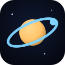
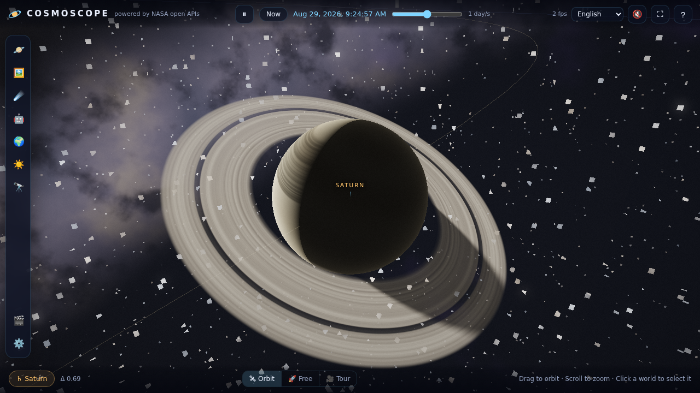

<div align="center">



# 🪐 Cosmoscope

### A ray-traced, real-ephemeris journey through the Solar System — powered by NASA's open APIs

**[▶ Launch the app](https://genovese-felipe.github.io/nasa-apis-fable5/)** · [User guide](docs/USER_GUIDE.md) · [Architecture](docs/ARCHITECTURE.md) · [NASA APIs](docs/NASA_APIS.md) · [Testing](docs/TESTING.md)

*Planets are where they really are, right now.*




</div>

---

**Cosmoscope** is a single-page WebGL2 application with **zero runtime dependencies** — no three.js, no frameworks, no build step required. Every pixel you see is produced by a **real-time ray tracer** written from scratch in GLSL: analytic ray–sphere and ray–plane intersections, penumbral shadow rays (watch the Moon eclipse the Sun!), fully procedural planet surfaces, Saturn's rings with the Cassini division, an HDR bloom pipeline, and a star field with a hand-tinted Milky Way.

Planet positions are not decorative: they come from the **JPL/Standish Keplerian elements** (Table 1, valid 1800–2050), solved live with Newton–Raphson at every frame. Scrub time from real-time to a year per second and watch the clockwork run — forwards or backwards.

## ✨ Features

| | |
|---|---|
| 🔦 **Ray-traced rendering** | Per-pixel primary + shadow rays, soft penumbras, real solar eclipses, ring shadows, atmospheric limb scattering, procedural surfaces for all 10 bodies |
| 🕰 **Real ephemeris** | JPL Standish elements + Kepler solver; the sky matches reality for any date between 1800 and 2050 |
| 🛰 **Orbit / Free / Tour cameras** | Inertial orbiting, WASD free-flight, and a cinematic Grand Tour with eased flights — never a teleport |
| 🖼 **8 NASA data sources** | APOD, NeoWs asteroids, EPIC Earth imagery, DONKI space weather, Mars rover imagery, Image & Video Library, NASA sonifications — see [docs/NASA_APIS.md](docs/NASA_APIS.md) |
| ☀️ **Live space weather** | Recent M/X-class flares from DONKI visibly energize the rendered Sun |
| 🎨 **Quality tuning** | Low → Ultra presets, render-scale slider, toggles for bloom, soft shadows, belt dust, film grain |
| 📸 **4K & 8K stills** | Tiled offline ray-tracing exports PNG/JPEG/WebP at up to 7680×4320 — beyond your screen resolution |
| 🎬 **Video recording** | MediaRecorder capture with **MP4 (H.264)** where the platform supports it (Chrome 126+, Safari), WebM VP9/VP8 everywhere else — soundtrack included |
| 🔊 **Procedural audio** | The entire soundscape is synthesized in Web Audio — drone, reverbed pad, solar wind that swells near the Sun, UI blips, and per-planet **data sonification** |
| 🌍 **9 languages** | English, 中文, Português, Español, 한국어, Français, Deutsch, 日本語, Русский — fully translated UI, facts, and tour captions |
| ♿ **Accessible** | Keyboard parity for everything, ARIA labeling, focus management, `prefers-reduced-motion` support, DOM panels as the source of truth |
| 📱 **Mobile-ready** | Touch orbit + pinch zoom, responsive bottom-sheet layout |
| 📦 **Offline-graceful** | Every API has an embedded sample fallback; the whole app also builds into one self-contained HTML file |

## 🚀 Quick start

**Online:** open the [GitHub Pages deployment](https://genovese-felipe.github.io/nasa-apis-fable5/).

**Locally:** any static server works — there is no build step:

```bash
git clone https://github.com/Genovese-Felipe/NASA-APIs-Fable5.git
cd NASA-APIs-Fable5
python3 -m http.server 8080        # or: npx http-server
# → http://localhost:8080
```

**Single file:** `node scripts/build-artifact.mjs` produces `dist/cosmoscope-standalone.html` — one 240 KB file you can double-click, e-mail, or drop on any host.

### Enabling GitHub Pages (one-time)

Repo **Settings → Pages → Build and deployment → Source: “GitHub Actions”**. From then on every push to `main` deploys automatically via [`deploy-pages.yml`](.github/workflows/deploy-pages.yml).

### NASA API key

The app ships using NASA's shared `DEMO_KEY` (≈30 requests/hour per IP). For a smoother experience grab a free key at [api.nasa.gov](https://api.nasa.gov) and paste it in **Settings → NASA API** — it is stored in your browser's localStorage only and never leaves your machine. Four of the app's data sources (EPIC, DONKI, Image Library, sonifications) don't need a key at all.

## 🎮 Controls

| Input | Action |
|---|---|
| **Drag** / one finger | Orbit the camera |
| **Scroll** / pinch | Zoom |
| **Click** a world or its label | Select & fly to it |
| **1–9, 0** | Select Mercury → Neptune, Moon, Sun |
| **Space** | Pause / resume time |
| **, / .** | Slower / faster time |
| **O / F / T** | Orbit / Free-flight / Grand Tour camera |
| **W A S D Q E** + drag, **Shift** boost | Fly (free mode) |
| **L / P** | Toggle labels / orbit paths |
| **S / R** | Screenshot / record video |
| **H or ?** | Help overlay |

## 🔭 What to try first

1. Press **T** — the Grand Tour flies you past every world with localized fact cards.
2. Open **☄️ Asteroids** and tick *Visualize flybys* — this week's real near-Earth objects appear around Earth.
3. Open **☀️ Space Weather** — if the Sun has flared recently, watch it seethe.
4. Select the **Moon**, set speed to *1 day/s*, and wait for a solar eclipse — the penumbra is computed by actual shadow rays.
5. Switch **Settings → Scale model → True scale** to feel how empty space really is.
6. In **🎬 Capture**, export an **8K still** — the frame is ray-traced tile by tile at full quality, no upscaling.
7. Try the **♪ Sonify** button on Neptune, then on Mercury — each world sings its orbital data.

## 🏗 Repository layout

```
index.html                  app shell (semantic DOM, ARIA)
css/app.css                 glassy dark UI, responsive, reduced-motion aware
js/
  engine.js                 WebGL2 ray tracer + post pipeline + tiled 8K export
  orbits.js                 JPL/Standish ephemeris, scene scaling (node-testable)
  i18n.js                   9 complete language tables (node-testable)
  audio.js                  procedural Web Audio soundscape + sonification
  nasa.js                   API client: caching, fallbacks, verified endpoints
  capture.js                stills + MediaRecorder MP4/WebM
  ui.js                     panels, tabs, NASA views, settings, toasts
  main.js                   simulation clock, cameras, input, render loop
scripts/build-artifact.mjs  single-file + artifact builds
tests/unit                  ephemeris & i18n integrity (node --test)
tests/e2e                   Playwright smoke: render → panels → export → record
.github/workflows           CI + Pages deployment
docs/                       guides, API notes, screenshots
```

## 🧪 Verification

```bash
node --test tests/unit/*.test.mjs   # Kepler solver, Standish table, i18n parity
node scripts/build-artifact.mjs     # single-file builds + bundle sanity checks
node tests/e2e/smoke.mjs            # real-browser journey (needs playwright)
```

The e2e run drives the actual user journey in headless Chromium: boot → render sanity (non-black pixel analysis) → language switching → NASA panels (including the offline fallback path) → still export → video recording. See [docs/TESTING.md](docs/TESTING.md).

## 📜 Credits & license

- Code: [MIT](LICENSE) © Felipe Genovese.
- Planetary ephemeris: E.M. Standish (JPL), *Keplerian Elements for Approximate Positions of the Major Planets*; physical data from the [NSSDC planetary fact sheets](https://nssdc.gsfc.nasa.gov/planetary/factsheet/).
- Data & imagery: courtesy of NASA — APOD, NeoWs, EPIC/DSCOVR, DONKI/CCMC, Mars rover missions, and the NASA Image and Video Library. NASA does not endorse this project.
- Every texture, star, and sound in the 3D scene is generated procedurally — no third-party assets.
