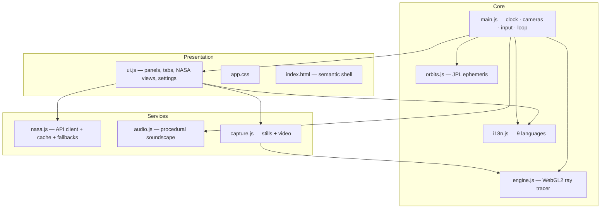
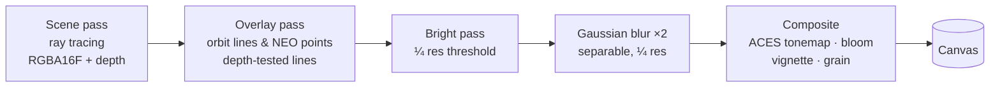

# Cosmoscope architecture

Cosmoscope is deliberately **dependency-free**: modern browsers already contain a GPU compiler (WebGL2/GLSL), a synthesizer (Web Audio), a video encoder (MediaRecorder), and an i18n runtime (`Intl`). The application is ~6,000 lines of vanilla ES modules orchestrating those built-ins.

## Module graph

`orbits.js` and `i18n.js` are pure modules with no DOM access — Node imports them directly for unit testing.

## The rendering pipeline

Each frame walks this GPU pipeline (all passes are full-screen triangles except the overlay):

### Scene pass — a real ray tracer

For every pixel the fragment shader:

1. Builds a primary ray from the camera basis and (tiling-aware) NDC.
2. Intersects it **analytically** against all bodies (`iSphere`) and Saturn's ring plane.
3. At the hit point, fires a **shadow ray** toward the Sun and computes the *fraction of the solar disc* occluded by every other body — comparing angular radii yields soft penumbras, which is why solar eclipses on Earth and ring shadows on Saturn simply emerge from the math.
4. Shades with procedural surfaces: FBM/ridged value noise builds continents, maria, cloud belts, the Great Red Spot; Earth gets specular ocean glints, drifting clouds and night-side city lights; the Sun gets granulation, limb darkening and a DONKI-driven activity level.
5. Misses fall through to a procedural star field (two hash-based star layers, an FBM Milky Way with dust lanes, faint nebulae).
6. Writes `gl_FragDepth` from the hit distance so the *rasterized* orbit-line pass can depth-test correctly against the *ray-traced* scene — the two worlds share one view-projection matrix.

Quality presets recompile the shader with different `#define`s (FBM octaves, soft shadows, belt dust), so toggles cost nothing at runtime.

### Tiled 8K export

`Engine.renderStill(w, h)` ray-traces arbitrary resolutions without ever allocating an 8K framebuffer:

1. A preview-resolution pass (≤1600 px) builds the **bloom** texture once — bloom is low-frequency, so sampling it upscaled per tile composes seamlessly.
2. The virtual frame is split into ≤2048 px tiles; each tile re-renders the scene with a `uSubRect` offset into the same camera frustum (off-center projection), composites with the shared bloom, and is read back with `readPixels`.
3. Tiles are stitched (y-flipped) into a 2D canvas, which `toBlob`s to PNG/JPEG/WebP.

This sidesteps `MAX_RENDERBUFFER_SIZE` limits, MSAA memory blow-ups and GPU watchdog timeouts, and keeps the UI responsive (a `setTimeout(0)` yield per tile).

## Ephemeris

`orbits.js` implements E.M. Standish's *Approximate Positions of the Major Planets* (JPL SSD):

- Elements `a, e, I, L, ϖ, Ω` propagate linearly in Julian centuries from J2000.
- Kepler's equation `M = E − e·sin E` is solved by Newton–Raphson (≤10 iterations, 1e-9 tolerance).
- Orbital-plane coordinates rotate through `ω, I, Ω` into the J2000 ecliptic frame, then into the Y-up scene frame.
- The Moon uses a simplified Keplerian orbit with nodal regression (18.6 y) and apsidal precession (8.85 y).

Two scale models share the machinery: **showcase** compresses distances (`6·au^0.55`) and inflates radii (`0.05·√(km/6371)`) so all worlds are visible together; **true scale** maps 1 au = 6 units with honest radii.

## The NASA client

`nasa.js` encodes *empirically verified* endpoint decisions (2026-08):

| Concern | Decision |
|---|---|
| EPIC | `epic.gsfc.nasa.gov` directly (api.nasa.gov proxy 302s to a 404) |
| DONKI | `kauai.ccmc.gsfc.nasa.gov` first (api.nasa.gov 503s), proxy as backup |
| Mars rovers | Image & Video Library search (the dedicated API died with its Heroku backend) |
| Rate limits | localStorage cache with per-source TTLs; 429 → user-facing hint to add a free key |
| Offline / sandboxed | every source degrades to embedded sample data with a visible badge |

## Audio

Everything is synthesized at runtime: detuned sine drone, triangle pad through a generated impulse-response convolver, pink-noise rumble and a solar-wind band-pass whose gain tracks camera–Sun distance. `sonify()` turns a body's orbital period, radius and eccentricity into a pentatonic arpeggio. The `AudioContext` is created only inside a user gesture (autoplay policy), and recordings tap the master bus through a `MediaStreamDestination`.

## Build

`scripts/build-artifact.mjs` concatenates the modules (dependency-ordered, imports stripped, exports unwrapped, duplicate-name guard) into:

- `dist/cosmoscope-standalone.html` — a complete document that runs from `file://`.
- `dist/artifact.html` — a `<title>/<style>/markup/<script>` fragment for publishing as a Claude Artifact (its host wraps the fragment in a document shell; its CSP blocks external hosts, which the app treats as the offline path).
