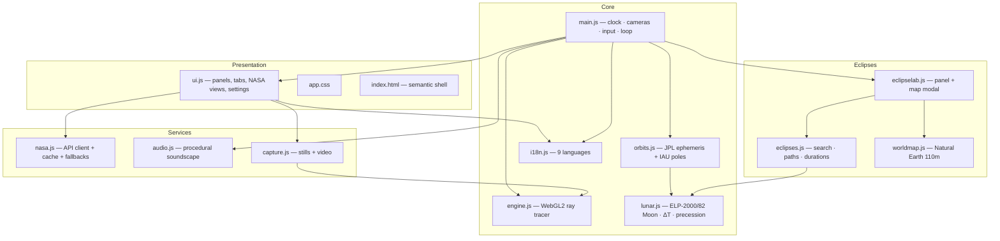
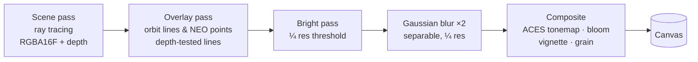

# Cosmoscope architecture

Cosmoscope is deliberately **dependency-free**: modern browsers already contain a GPU compiler (WebGL2/GLSL), a synthesizer (Web Audio), a video encoder (MediaRecorder), and an i18n runtime (`Intl`). The application is ~4,000 lines of vanilla ES modules (≈5,000 with tests and tooling) orchestrating those built-ins.

## Module graph

`orbits.js`, `lunar.js`, `eclipses.js` and `i18n.js` are pure modules with no DOM access — Node imports them directly for unit testing.

## The rendering pipeline

Each frame walks this GPU pipeline (all passes are full-screen triangles except the overlay):

### Scene pass — a real ray tracer

For every pixel the fragment shader:

1. Builds a primary ray from the camera basis and (tiling-aware) NDC.
2. Intersects it **analytically** against all bodies (`iSphere`) and Saturn's ring plane.
3. At the hit point, fires a **shadow ray** toward the Sun and computes the *fraction of the solar disc* occluded by every other body — comparing angular radii yields soft penumbras, which is why solar eclipses on Earth and ring shadows on Saturn simply emerge from the math.
4. Shades with procedural surfaces: FBM/ridged value noise builds continents, maria, cloud belts, the Great Red Spot; Earth gets specular ocean glints, drifting clouds and night-side city lights; the Sun gets granulation, limb darkening and a DONKI-driven activity level.
5. Misses fall through to a procedural star field (two hash-based star layers, an FBM Milky Way with dust lanes, faint nebulae).
6. Writes `gl_FragDepth` from the hit distance so the *rasterized* orbit-line pass can depth-test correctly against the *ray-traced* scene — the two worlds share one view-projection matrix.

Quality presets recompile the shader with different `#define`s (FBM octaves, soft shadows, belt dust), so toggles cost nothing at runtime.

### Tiled 8K export

`Engine.renderStill(w, h)` ray-traces arbitrary resolutions without ever allocating an 8K framebuffer:

1. A preview-resolution pass (≤1600 px) builds the **bloom** texture once — bloom is low-frequency, so sampling it upscaled per tile composes seamlessly.
2. The virtual frame is split into ≤2048 px tiles; each tile re-renders the scene with a `uSubRect` offset into the same camera frustum (off-center projection), composites with the shared bloom, and is read back with `readPixels`.
3. Tiles are stitched (y-flipped) into a 2D canvas, which `toBlob`s to PNG/JPEG/WebP.

This sidesteps `MAX_RENDERBUFFER_SIZE` limits, MSAA memory blow-ups and GPU watchdog timeouts, and keeps the UI responsive (a `setTimeout(0)` yield per tile).

## Ephemeris

`orbits.js` implements E.M. Standish's *Approximate Positions of the Major Planets* (JPL SSD):

- Elements `a, e, I, L, ϖ, Ω` propagate linearly in Julian centuries from J2000.
- Kepler's equation `M = E − e·sin E` is solved by Newton–Raphson (≤10 iterations, 1e-9 tolerance).
- Orbital-plane coordinates rotate through `ω, I, Ω` into the J2000 ecliptic frame, then into the Y-up scene frame.
- The Moon uses the truncated **ELP‑2000/82** theory from Meeus ch. 47: 60 longitude/distance terms and 60 latitude terms, plus the Venus, Jupiter and flattening corrections. It reproduces Meeus example 47.a to 0.002″. The geocentric of-date result is precessed to J2000 (Meeus 21.7). UTC is converted to dynamical time with ΔT. That is observed values for 1990–2025 and the full Espenak–Meeus piecewise polynomials elsewhere, blended continuously into the 2050–2150 expression.
- Earth itself is placed at the **Earth–Moon barycentre minus μ·Moon** (μ = 1/82.3), so the 4,700 km wobble that matters for eclipses is modeled.
- Every body has a real **rotation axis** from the IAU WGCCRE pole right ascension and declination, rotated into the ecliptic scene frame. Seasons and Saturn's ring-plane crossings (2025) come out of the geometry; the unit tests check them.

Two scale models share the machinery: **showcase** compresses distances (`6·au^0.55`) and inflates radii (`0.05·√(km/6371)`) so all worlds are visible together; **true scale** maps 1 au = 6 units with honest radii.

## Eclipse engine

`eclipses.js` is a small eclipse predictor working directly from the ephemerides above (no pre-computed tables):

1. **Search.** It steps through new and full moons (synoptic month from the mean phase) and keeps those near a node, where |β| is small.
2. **Greatest eclipse.** It finds the minimum of the shadow-axis distance (solar) or the Moon–shadow-centre separation (lunar) by golden-section search in dynamical time. The Sun comes from Standish EMB minus the Moon's barycentric share, precessed to date, with annual aberration (−20.4898″/R).
3. **Solar geometry.** It works in the fundamental plane, Besselian style: gamma is the axis's closest approach in Earth radii, and the penumbral and umbral cone radii L1/L2 are taken at the observer. The shadow axis is intersected with the **WGS‑84 ellipsoid** to give the ground point and central line. Path width uses the support function of the umbral footprint ellipse. Central duration bisects the second and third contacts at the greatest-eclipse point. As NASA does, the umbra and antumbra use the smaller lunar radius k = 0.272281 (limb valleys) and penumbral contacts use k = 0.2725076.
4. **Classification.** Total, annular, hybrid or partial follows from the sign of L2 along the path. The path's exact first and last instants are found by bisection, which catches hybrid stretches lasting only seconds. Whether a partial eclipse happens at all is tested against Earth's flattened outline in the fundamental plane. Lunar eclipses use Danjon's 1/85 atmospheric enlargement of a flattening-corrected Earth radius.
5. **Local circumstances.** `localSolar()` gives topocentric obscuration and solar altitude for any point on Earth. The Eclipse Lab samples it on a 2° grid to paint the partial-eclipse field.

Validation (`tests/unit/eclipses.test.mjs`) runs against all 24 eclipses of 2026–2030 in NASA's catalog. Every eclipse is found with the correct type. Greatest eclipse lands within 1 minute, gamma within 0.001, magnitude within 0.002, central duration within 1 s, and the ground point within 0.5°. Classic eclipses outside that window (1973, the 2013 and 2023 hybrids, 2017, 2024) are checked as well.

`eclipselab.js` draws an equirectangular canvas map. `worldmap.js` provides the Natural Earth 110m land rings and border arcs, delta-encoded and decoded at load (43 KB). On top it shades night from the subsolar point, adds a red obscuration field that animates with time, and draws the north and south limits plus the central line. **Watch in 3D** calls `app.actions.jumpTo()`, which moves the simulation to the eclipse instant at true scale. The ray tracer then shows the result directly: the umbra on Earth, or the blood-red Moon. The shader's Earth-shadow factor tints lunar surfaces deep red.

## The NASA client

`nasa.js` encodes *empirically verified* endpoint decisions (2026-08):

| Concern | Decision |
|---|---|
| EPIC | `epic.gsfc.nasa.gov` directly (api.nasa.gov proxy 302s to a 404) |
| DONKI | `kauai.ccmc.gsfc.nasa.gov` first (api.nasa.gov 503s), proxy as backup; both currently down upstream (2026-11), so the embedded sample shows |
| Mars rovers | Image & Video Library search (the dedicated API died with its Heroku backend) |
| Rate limits | localStorage cache with per-source TTLs; 429 → user-facing hint to add a free key |
| Offline / sandboxed | every source degrades to embedded sample data with a visible badge |

## Audio

Everything is synthesized at runtime: detuned sine drone, triangle pad through a generated impulse-response convolver, pink-noise rumble and a solar-wind band-pass whose gain tracks camera–Sun distance. `sonify()` turns a body's orbital period, radius and eccentricity into a pentatonic arpeggio. The `AudioContext` is created only inside a user gesture (autoplay policy), and recordings tap the master bus through a `MediaStreamDestination`.

## Build

`scripts/build-artifact.mjs` concatenates the modules (dependency-ordered, imports stripped, exports unwrapped, duplicate-name guard) into:

- `dist/cosmoscope-standalone.html` — a complete document that runs from `file://`.
- `dist/artifact.html` — a `<title>/<style>/markup/<script>` fragment for publishing as a Claude Artifact (its host wraps the fragment in a document shell; its CSP blocks external hosts, which the app treats as the offline path).
